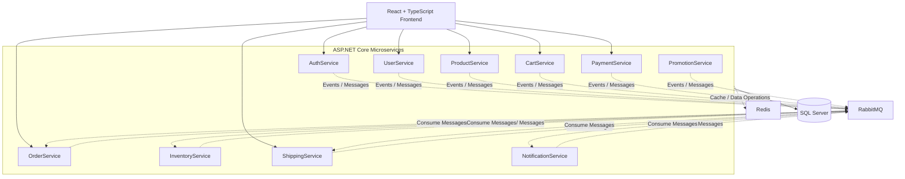

# EcomSystem — Microservices E-Commerce Platform

A full-stack e-commerce platform built with **C#, ASP.NET Core, React, TypeScript, and SQL Server**, using a microservices architecture to separate business capabilities and support independent service development.

The system covers the core e-commerce lifecycle, including authentication, product catalog management, shopping cart operations, order processing, payment simulation, inventory management, shipping, promotions, and notifications.

## Table of Contents

- [Overview](#overview)
- [Key Features](#key-features)
- [Technology Stack](#technology-stack)
- [System Architecture](#system-architecture)
- [Microservices](#microservices)
- [Business Workflows](#business-workflows)
- [Inter-Service Communication](#inter-service-communication)
- [Database and Persistence](#database-and-persistence)
- [Getting Started](#getting-started)
- [Service Endpoints](#service-endpoints)
- [Configuration](#configuration)
- [Troubleshooting](#troubleshooting)
- [Future Improvements](#future-improvements)

## Overview

EcomSystem is a full-stack e-commerce project designed to explore backend development, distributed system design, asynchronous messaging, and containerized application deployment.

The backend is organized into 10 business-oriented microservices built with ASP.NET Core. Each service focuses on a specific domain, while RabbitMQ supports event-driven communication between services. SQL Server provides relational data persistence, Redis is included in the infrastructure, and Docker is used to containerize the application and its dependencies.

The frontend is built with React and TypeScript, providing a user interface for shopping and role-specific workflows.

### Project Highlights

- **10 microservices** organized around distinct business responsibilities.
- **Clean Architecture** to separate business logic, application logic, and infrastructure concerns.
- **RabbitMQ** for asynchronous, event-driven inter-service communication.
- **Entity Framework Core** for data access and database operations.
- **JWT authentication and role-based authorization** for different user types.
- **Docker-based development environment** for running backend services and supporting infrastructure.
- **End-to-end e-commerce workflows**, including cart management, checkout, payment simulation, order tracking, cancellation, and returns.

## Key Features

### Authentication and Authorization

- User registration and login.
- JWT-based authentication.
- Role-based access control for different application workflows.
- Protected operations based on user roles.

### Product Catalog

- Browse and retrieve product information.
- Manage products through seller-oriented workflows.
- Integrate product information with shopping cart and order processing.

### Shopping Cart and Checkout

- Add products to the shopping cart.
- Manage cart contents before checkout.
- Initiate the order creation process from selected items.

### Order Management

- Create and process customer orders.
- Track order status throughout the order lifecycle.
- Support order cancellation according to the implemented workflow.
- Handle return-related workflows.

### Payment Processing

- Simulated QR payment workflow.
- Cash on Delivery (COD).
- Integrate payment processing with order management.

> **Note:** QR payment is a mock/simulated payment workflow, not a claim of integration with a real banking or payment provider.

### Inventory Management

- Manage product stock.
- Support inventory-related operations associated with order processing.
- Separate inventory responsibilities from product catalog and order management.

### Shipping and Order Tracking

- Support shipper-oriented workflows.
- Manage shipping operations and delivery status.
- Connect shipping progress with the order lifecycle.

### Promotions

- Separate promotion-related business logic into a dedicated service.
- Support the promotion capabilities implemented in the application.

### Notifications

- Dedicated service for notification-related operations.
- Integrate with relevant business workflows across the platform.

### Administration

- Role-specific administrative workflows.
- Access control for administrative operations.
- Support platform management through the relevant services and frontend interfaces.

## Technology Stack

| Category | Technologies |
|---|---|
| Programming Language | C# |
| Backend Framework | ASP.NET Core |
| Architecture | Microservices, Clean Architecture |
| ORM | Entity Framework Core |
| Database | Microsoft SQL Server |
| Messaging | RabbitMQ |
| Cache / In-Memory Data Infrastructure | Redis |
| Authentication | JWT, Role-Based Authorization |
| Frontend | React, TypeScript, HTML5, CSS3 |
| Containerization | Docker, Docker Compose |
| Version Control | Git, GitHub |

## System Architecture

The application separates business capabilities into independently organized services. The frontend communicates with backend APIs, while backend services exchange information through their implemented communication mechanisms.



The diagram illustrates the logical components and possible message flows. Actual routing, event subscriptions, database ownership, and Redis usage depend on each service's implementation and configuration.

### Architectural Principles

**Separation of concerns**

Each microservice is responsible for a specific business capability, helping reduce direct dependencies between unrelated modules.

**Clean Architecture**

The backend follows a layered design intended to separate application and business logic from infrastructure concerns.

**Event-driven communication**

RabbitMQ provides a messaging mechanism for asynchronous communication where event-based integration is implemented.

**Containerized development**

Docker provides a consistent environment for running services and supporting infrastructure during development.

## Microservices

The backend consists of the following 10 services.

| # | Service | Port | Responsibility |
|---:|---|---:|---|
| 1 | AuthService | `5001` | Registration, login, authentication, and JWT-related operations |
| 2 | CartService | `5002` | Shopping cart management |
| 3 | ProductService | `5003` | Product catalog and product management |
| 4 | UserService | `5004` | User profiles and user-related operations |
| 5 | NotificationService | `5039` | Notification-related operations |
| 6 | InventoryService | `5270` | Stock and inventory management |
| 7 | PromotionService | `5278` | Promotion-related business logic |
| 8 | ShippingService | `5243` | Shipping operations and delivery tracking |
| 9 | PaymentService | `5289` | Payment workflows, including simulated QR payment and COD |
| 10 | OrderService | `5290` | Order creation, processing, cancellation, and return workflows |

The ports above reflect the project's previously used local development configuration. Verify the current Docker Compose and application configuration before changing the ports or publishing the repository documentation.

### Service Responsibilities

- **AuthService:** Handles authentication-related operations and token issuance.
- **UserService:** Manages user information and profile-related operations.
- **ProductService:** Owns product catalog functionality.
- **CartService:** Handles shopping cart operations before checkout.
- **OrderService:** Coordinates order-related business workflows.
- **PaymentService:** Handles payment records and supported payment workflows.
- **InventoryService:** Manages stock-related operations.
- **PromotionService:** Encapsulates promotion functionality.
- **ShippingService:** Handles shipment and delivery-related operations.
- **NotificationService:** Provides a dedicated location for notification functionality.

## Business Workflows

### 1. Authentication

1. A user submits registration or login information through the frontend.
2. AuthService processes the authentication request.
3. The client receives the authentication response.
4. Protected API operations use JWT authentication and applicable role-based authorization.

### 2. Shopping and Checkout

1. The customer browses available products.
2. The customer adds products to the shopping cart.
3. The customer proceeds to checkout.
4. Order processing creates and manages the order.
5. Inventory and payment operations participate in the implemented order workflow.
6. The order progresses through the relevant processing and delivery statuses.

### 3. Payment

The application supports the payment workflows implemented for:

- QR-based mock payment.
- Cash on Delivery (COD).

Payment outcomes are handled within the application's payment and order workflows. The mock QR flow should not be interpreted as a production banking integration.

### 4. Shipping and Delivery

1. An order proceeds to the relevant shipping stage.
2. ShippingService manages shipping-related operations.
3. Shippers use the available role-specific workflow.
4. Delivery progress can be reflected in order tracking.

### 5. Cancellation and Returns

The application includes order cancellation and return-related workflows. The exact eligibility rules, status transitions, stock restoration behavior, and refund behavior depend on the implemented business logic.

## Inter-Service Communication

RabbitMQ is included as the messaging infrastructure for asynchronous communication between backend services.

Event-driven messaging can help reduce synchronous dependencies and allow consumers to process business events independently.

Typical integration scenarios include:

- Order-related events consumed by inventory or shipping workflows.
- Payment-related events consumed by order processing.
- Business events that trigger notification operations.

These examples describe the intended integration scenarios; the exact event names, exchanges, queues, routing keys, retry policies, and consumers should be verified against the source code.

### Why RabbitMQ?

- Decouples producers from message consumers.
- Supports asynchronous processing.
- Helps services react to business events without requiring every operation to be completed synchronously.
- Provides a foundation for more resilient distributed workflows.

For production-grade reliability, message delivery, idempotent consumers, retry handling, dead-letter queues, and transactional consistency must be explicitly implemented and tested.

## Database and Persistence

### SQL Server

Microsoft SQL Server is used as the relational database.

Entity Framework Core provides the ORM layer for database access and persistence operations.

Typical responsibilities include:

- Persisting application entities.
- Executing queries and updates.
- Managing database schema changes through migrations where configured.
- Supporting business workflows across the application.

### Redis

Redis is included in the project's infrastructure for in-memory data operations.

Its exact role should be described according to the current implementation. Redis should not automatically be assumed to cache every service's data or manage every authentication session.

### Data Ownership

In a microservices architecture, each service should ideally own its business data and expose it through well-defined interfaces or messages. If multiple services currently share a database or database instance, document the actual arrangement rather than claiming fully independent databases.

## Getting Started

The following instructions describe the general local development workflow. Confirm the actual repository layout, Compose service names, environment variable names, and startup dependencies before using these commands in a fresh environment.

### Prerequisites

Install the following tools:

- [Git](https://git-scm.com/)
- [Docker Desktop](https://www.docker.com/products/docker-desktop/)
- [.NET SDK](https://dotnet.microsoft.com/download)
- [Node.js](https://nodejs.org/)
- [SQL Server](https://www.microsoft.com/en-us/sql-server) if running the database outside Docker

Docker Desktop should be running before starting the containerized environment.

### 1. Clone the Repository

```bash
git clone https://github.com/vugiabao3/ecom-system.git
cd ecom-system
```

### 2. Configure Environment Settings

Before starting the services:

1. Inspect the root directory for `docker-compose.yml` or `compose.yaml`.
2. Review each service's configuration files.
3. Configure SQL Server connection strings.
4. Configure RabbitMQ and Redis connection settings.
5. Configure JWT signing settings.
6. Update frontend API base URLs when necessary.

Use environment variables or local development configuration for secrets. Do not commit production credentials, database passwords, or JWT signing keys.

### 3. Start the Infrastructure and Services

If the root Compose file defines the complete application stack, use:

```bash
docker compose up -d --build
```

Check the container status:

```bash
docker compose ps
```

View service logs:

```bash
docker compose logs --tail=100
```

To inspect a specific service, use its actual Compose service name:

```bash
docker compose logs -f <service-name>
```

The placeholders must be replaced with service names defined in the Compose file.

### 4. Verify the Local Services

The previously used local development endpoints are:

| Component | Local Address |
|---|---|
| Frontend | `http://localhost:5173` |
| AuthService | `http://localhost:5001` |
| CartService | `http://localhost:5002` |
| ProductService | `http://localhost:5003` |
| UserService | `http://localhost:5004` |
| NotificationService | `http://localhost:5039` |
| InventoryService | `http://localhost:5270` |
| PromotionService | `http://localhost:5278` |
| ShippingService | `http://localhost:5243` |
| PaymentService | `http://localhost:5289` |
| OrderService | `http://localhost:5290` |
| RabbitMQ Management UI | `http://localhost:15672` |

These are local addresses, not public deployment URLs. An endpoint is usable only when the corresponding service is running, its port is published, and the route exists in the application.

### 5. Run the Frontend Separately

If the frontend is not started by Docker Compose, open a terminal in the frontend directory containing `package.json`.

```bash
npm install
npm run dev
```

Open the local address printed by Vite, commonly:

```text
http://localhost:5173
```

Check the frontend environment configuration to ensure API requests target the correct backend addresses.

### 6. Stop the Environment

To stop the containers defined by the Compose project:

```bash
docker compose down
```

This stops and removes the Compose-managed containers and network. Named volumes are normally retained unless explicitly removed.

Avoid using `docker compose down -v` when you need to preserve local database data.

## Service Endpoints

The service ports identify the local development entry points. Individual API routes should be documented from the actual controllers or OpenAPI specifications.

For API testing:

1. Start the relevant backend service.
2. Open its configured Swagger UI if Swagger/OpenAPI is enabled.
3. Register or authenticate a user as required.
4. Include the appropriate bearer token for protected endpoints.
5. Test the business workflow and inspect the service logs.

Example authorization header:

```http
Authorization: Bearer <your-access-token>
```

Do not assume every service exposes Swagger at `/swagger` or that all endpoints are publicly accessible; check each service's configuration.

## Configuration

The application depends on environment-specific settings, including:

| Configuration | Purpose |
|---|---|
| SQL Server connection string | Database connectivity |
| RabbitMQ host and credentials | Message broker connectivity |
| Redis host and port | Redis connectivity |
| JWT signing key and validation settings | Authentication and token validation |
| Frontend API base URL | Routing requests to backend services |
| Service ports | Local access and container port mapping |

### Security Recommendations

- Keep credentials and signing keys out of source control.
- Use separate configuration for local development and deployment.
- Replace development secrets before deployment.
- Restrict access to database and message broker management interfaces.
- Validate authentication and authorization on protected endpoints.
- Avoid exposing internal infrastructure ports publicly without a clear requirement.

## Troubleshooting

### Docker containers fail to start

```bash
docker compose ps
docker compose logs --tail=200
```

Check the logs for configuration errors, unavailable dependencies, port conflicts, or failed health checks.

### A port is already in use

On Windows PowerShell:

```powershell
netstat -ano | findstr :5001
```

Replace `5001` with the affected port. Identify the process before stopping it, or configure a different host port.

### Database connection fails

Verify that SQL Server is running and that the connection string uses the correct hostname and port.

When a service runs inside Docker, `localhost` refers to that service's own container, not another container. Use the appropriate Compose service name for container-to-container communication.

### RabbitMQ connection fails

Check the RabbitMQ container status and logs, then verify the broker hostname, port, credentials, and queue/exchange configuration.

The management interface is typically available at port `15672` when that port is published.

### Frontend cannot reach the backend

Verify the API base URL, backend availability, CORS configuration, and published ports.

A frontend accessed from another computer cannot normally reach a backend by using the developer's `localhost` address.

## Future Improvements

Potential areas for further development include:

- Automated unit and integration tests.
- Centralized logging and distributed tracing.
- Health checks and service observability.
- Consistent API documentation across services.
- Resilient RabbitMQ consumers with retries and dead-letter queues.
- Idempotent event processing and improved distributed transaction handling.
- CI/CD pipelines and deployment automation.
- Improved secret management and production-specific security configuration.

These are potential improvements, not claims that the features are already implemented.

## Author

**Developer:** [vugiabao3](https://github.com/vugiabao3)

**Repository:** [EcomSystem](https://github.com/vugiabao3/ecom-system)

**Primary Focus:** Backend Development — C#, ASP.NET Core, Entity Framework Core, SQL Server, Microservices, and RabbitMQ.

---

*This project is a learning and portfolio project intended to demonstrate full-stack development, backend architecture, service integration, and containerized development. Payment processing and deployment capabilities should be evaluated according to the actual implementation.*
